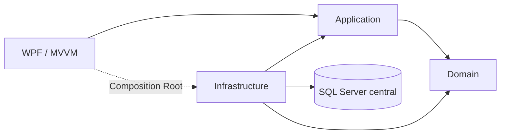

# Arquitectura de GoDental

Síntesis de DM-01 v0.2, secciones 3–6 y 18. Este archivo organiza la base del repositorio; no sustituye un futuro ARQ-01 revisado.

| Proyecto | Responsabilidad | Referencias permitidas en esta base |
| --- | --- | --- |
| Domain | Entities, Enums, ValueObjects, Rules | Ningún proyecto |
| Application | Interfaces, DTOs, Services, Validators, UseCases | Domain |
| Infrastructure | Data, Repositories, PDF, Fiscal, Importaciones, Online | Application, Domain |
| Wpf | Views, ViewModels, Navigation, Themes, Controls, Common | Application; Infrastructure sólo para composición |

## Operación inicial

Un almacén, una caja y dos laptops. La PC principal Windows 11 hospeda SQL Server y puede ejecutar WPF. Las estaciones comparten la misma base por LAN. LocalDB no es la base de producción. Una API remota es evolución futura; SQL Server no se expone directamente a Internet.

## Integridad

Application coordina transacciones completas para ventas, recepciones y cobros. Infrastructure implementará Dapper y SQL parametrizado. Stock y secuencias necesitan bloqueos y controles de servidor además de ROWVERSION. Los movimientos financieros y de inventario se compensan o anulan con trazabilidad, no se eliminan físicamente.

DB-01 propone los esquemas seg, sis, cat, inv, cmp, cli, ven, fis y com. Dinero DECIMAL(18,2), costos DECIMAL(18,6), cantidades DECIMAL(18,4), porcentajes DECIMAL(9,4), tipos de cambio DECIMAL(18,8), eventos DATETIMEOFFSET(0). Domain no depende de SQL Server.

## Presentación e integraciones

MVVM con temas claro/oscuro, paleta celeste/azul/verde y recursos centralizados. La interfaz debe diferenciarse de ClinicaDentalMario. QuestPDF generará documentos internos cuando se implemente el módulo. Venta no equivale a DTE. Online y DHL se integrarán mediante interfaces; el envío comercial exige revisión humana y canales autorizados.

## Alcance de esta base

Los proyectos y sus referencias están creados, sin clases ficticias de negocio ni implementación prematura del borrador DB-01. No incluye paquetes externos, Composition Root, aplicación ejecutable, SQL, autenticación ni funcionalidad comercial. El Worker se incorporará cuando existan tareas que deban continuar con WPF cerrado.
