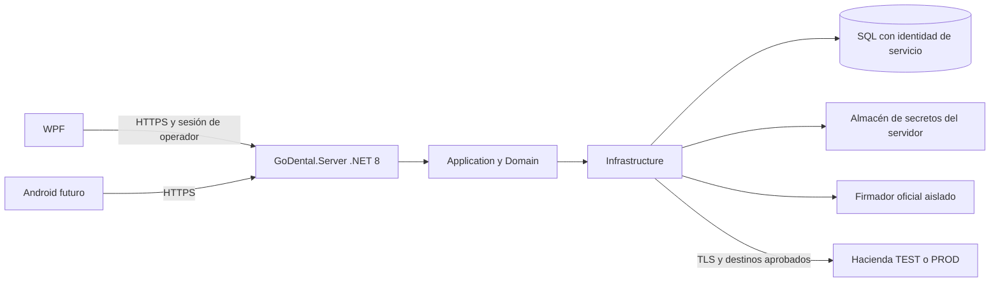

# Arquitectura DTE y diseño de GoDental.Server

**PREPARADO — diseño, sin proyecto servidor implementado.** Decisión ARQ-01 v0.2.
El diseño de responsabilidades queda definido aquí; firma/transporte y sus contratos permanecen
PENDIENTE_DE_CONTRATO_OFICIAL. No se reutilizará un adaptador Meta como transporte fiscal.

El acceso SQL comercial WPF actual sigue existiendo durante la transición. El diagrama muestra
el destino de las operaciones confiables nuevas; no afirma que todos los clientes ya usen API.
La emisión no se habilita mientras el cliente pueda modificar sus evidencias o suplantar al
operador mediante permisos SQL amplios. Cerrar SEC-01 incluye esa comprobación efectiva.

## Distribución por capas

| Componente | Responsabilidad y dependencias |
| --- | --- |
| Domain | Invariantes y valores fiscales definidos desde fuentes; sin SQL, WPF, HTTP o secretos |
| Application | Casos de uso, validadores separados, contexto de operador confiable, contratos de snapshot, artefactos, firma/transporte/secretos y coordinación durable |
| Infrastructure | Dapper, transacciones, almacén seguro, firma oficial, HttpClientFactory, artefactos y PDF; sin Views/ViewModels |
| GoDental.Server | Host ASP.NET Core .NET 8, HTTPS, autenticación, autorización, límites, composition root, procesos durables y respuestas internas sanitizadas |
| WPF | Preparar/revisar y consultar resultados, cliente HTTPS progresivo; sin certificado ni contraseña MH |

No mover reglas al controlador. No usar Service Locator ni registrar `UserSession` de escritorio
como singleton del servidor. Operador/contexto por petición; los workers usan una identidad de
servicio y la autorización/auditoría de la operación que originó el trabajo, revalidada según fase.
Ningún `IdUsuario`, `rol` o permiso recibido en JSON o cabecera sustituye al contexto autenticado.

## Identidad y sesión del servidor

Propuesta interna para el primer bloque B: sesión opaca de operador emitida por el servidor
tras comprobar contraseña y estado con el mecanismo PBKDF2 existente, bloqueo de intentos
y cambio obligatorio de contraseña. Guardar sólo hash del identificador de sesión, usuario,
estación registrada, creación, expiración, revocación y última actividad. La identidad Windows
de la estación no equivale por sí sola al operador GoDental.

Antes de codificar, cerrar en SEC-01 la política de duración/inactividad, alta de estaciones,
reautenticación sensible y revocación. No inventar números de duración en este diseño. La
sesión se valida en cada petición; permisos actuales se consultan del lado servidor, no se
congelan indefinidamente al iniciar sesión. Limitar intentos y tamaño de peticiones, usar TLS
válido, errores genéricos y respuestas de autenticación sin datos del usuario objetivo.

WPF conserva token en memoria durante la sesión; no en `workstation.json`. Si se necesita
persistencia futura, requiere almacén del SO y análisis de robo/revocación. Tokens y cabeceras
quedan fuera de logs/trazas/telemetría. No implementar autenticación mediante un API key
compartido entre todas las laptops ni un `IdUsuario` fijo en configuración.

## Interfaces internas previstas

Los nombres siguientes expresan responsabilidades; firmas definitivas se cierran por bloque:

- Contexto de operador autenticado y autorización actual; no reusar el contexto global WPF.
- Repositorio fiscal transaccional y coordinador de trabajos con lease/fencing en SQL.
- `IFiscalSecretStore`: referencia tipada por emisor, ambiente y propósito; acceso acotado
  al adaptador autorizado, sin devolver secretos a controladores, UI o logs.
- `ICodigoGeneracionProvider` y `INumeroControlProvider`: independientes de códigos
  comerciales, implementación bloqueada hasta validar T01–T04.
- `IDteSigner`: adaptador al firmador oficial; T05/T06 antes de definir su contrato externo.
- `IDteTransport`: autenticación/recepción/consulta oficiales, sin POST retry genérico.
- Calculador y validadores FE/CCFE, validación schema local, repositorio de contratos
  versionados y representaciones. No serializar `SaleData` o `CustomerData` directamente.

## Protocolo de operación durable

1. Autenticar y autorizar en servidor; validar operación, venta y revisión vigente.
2. En una transacción SQL: bloquear en orden definido, validar versiones, congelar snapshot,
   resolver idempotencia por alcance/emisor/ambiente/operador y registrar trabajo. La reserva de
   identidad/numeración sólo existirá cuando su contrato oficial se cierre.
3. Commit antes de IO externo. Nunca retener una transacción SQL mientras se llama a Hacienda.
4. Worker reclama trabajo con lease y token de fencing compartidos. Persistir intención de
   envío y hash de bytes **antes** de escribir a la red; un proceso viejo no puede confirmar
   resultados sobre un lease nuevo. Un lease vencido tras envío no autoriza reenvío automático.
5. Persistir respuesta o incertidumbre de forma atómica, con intento/correlación y auditoría.
   [Reconciliar](Reconciliacion.md) cuando no se conoce el resultado; el worker recupera al
   iniciar aun con WPF cerrado. La UI sólo consulta el resultado durable.

La autenticación MH es técnica, separada de la sesión del operador. No mantener un request
WPF abierto mientras se completa un proceso fiscal. Correlación interna sin PII ni secretos.

## SQL y despliegue progresivo

Identidad de servicio distinta de la del operador y distinta del instalador de migraciones.
No `sysadmin`/`db_owner` en runtime. Conceder sólo lecturas/ejecuciones necesarias y denegar
escritura directa de evidencias por clientes. La identidad de migración se usa sólo en ventana
controlada. No basta agregar un servidor si las cuentas de escritorio conservan permiso para
alterar sus tablas. Probar con logins reales limitados, no sólo con permisos de UI.

Primer despliegue objetivo: host Windows dedicado o equipo que aloje el servicio, identidad de
servicio y ACL propias, HTTPS LAN válido, firewall de entrada limitado y SQL sólo para el host
confiable en los recorridos migrados. Dominio público no es requisito para transmisión saliente
DTE; sí se necesita resolver certificado HTTPS accesible/confiable desde las estaciones.
No publicar SQL, certificados ni firmador en Internet. No habilitar omisión de validación TLS.

El worker puede vivir como `BackgroundService` del host, con estado en SQL y apagado acotado;
no necesita otro microservicio. Firma aislada en proceso/servicio según T05/T06 y permisos
mínimos. No decidir contenedor, puerto, formato de certificado o algoritmo antes de esas fuentes.

Pruebas de salida del bloque B: inicio sin secretos fiscales, rechazo anónimo/suplantación,
revocación, mínimo privilegio SQL, sesión aislada entre estaciones, rate limit, aislamiento de
ambientes, reinicio del host y logs sanitizados. Sólo entonces incorporar endpoints internos de
operaciones fiscales reales, definidos/documentados separadamente del contrato de Hacienda.
